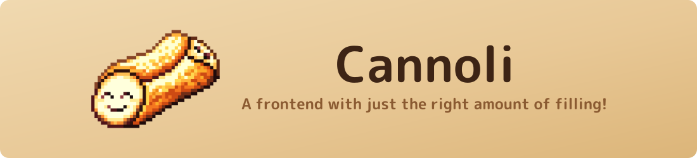

<div align="center">



<a href="LICENSE"></a>
<a href="https://github.com/CannoliHQ/cannoli/stargazers"></a>
<a href="https://github.com/CannoliHQ/cannoli/releases"></a>
<a href="https://cannoli.dev"></a>
<a href="https://crowdin.com/project/cannoli"></a>

</div>

---

# What is Cannoli?

Cannoli is an opinionated retro gaming setup for Android.

It comes with [built-in libretro cores](https://cannoli.dev/documentation/platforms/) and can also launch RetroArch / Standalone emulators like a traditional frontend.

---

# What does it look like?

<p align="center">
<a href=".github/resources/screenshots/main_menu.png"></a>
<a href=".github/resources/screenshots/favorites.png"></a>
<a href=".github/resources/screenshots/igm.png"></a>
</p>

---

# Why make another frontend?

`¯\_(ツ)_/¯`

I adore [MinUI](https://github.com/shauninman/MinUI) by [Shaun Inman](https://github.com/shauninman). No fuss, a focused
feature set, and unapologetically opinionated.

Without his masterpiece this derivative would not exist.

For that I thank him, and apologize for the bastardization that follows.

Since purchasing a Retroid Pocket Classic I've been yearning for MinUI's simplicity.

**This is my attempt to bring that experience to Android.**

---

# Design Goals

- Play Some Damn Games!
- Minimal Configuration
- Easy to add new games
- Basic features baked in
- Judicious addition of new features

## Fork: library scanning

Bundled platforms use case-insensitive, system-specific file allowlists, including
nested folders and game bundles. Game Boy accepts `.gb` and `.zip`; GameCube
accepts Dolphin formats such as `.iso`, `.rvz`, `.gcm`, `.gcz`, `.ciso`, and `.wia`,
but not Wii-only `.wbfs` or `.wad`. PICO-8 accepts `.p8` and `.p8.png`, not ordinary
artwork PNGs. Arcade scans index `.zip`/`.7z` ROM sets, not companion CHDs.

Supported playlists, CUE tracks, multi-disc bundles, and PC/Vita launcher shortcuts
remain supported. Unsupported files are excluded from the library on the next scan,
not deleted. Custom platform tags retain the previous scanning behavior.
The format catalog is `PlatformFileTypes.kt`, based on bundled libretro core
metadata and the configured standalone emulators.

## Fork: background resource use

Launcher status observers, clock/cursor timers, local list artwork decoding,
download-progress/list-state collection, and text marquees pause while its
activity is paused or its window loses focus.
ROM filesystem watchers remain event-driven, but coalesce automatic scan requests per
platform until the launcher is focused again; explicit scans still run when requested.
An already-running scan or image decode may finish. Warm game returns refresh the
database-backed lists without a disk rescan; activity recreation still follows the
automatic library-scan setting.

The internal emulator polls menu navigation only while a focused in-game menu is
open, not during gameplay. Its frame pacer does not restart while the activity is
paused or the game is paused in a menu. Emulation, audio, achievements, controller hotplug,
save handling, and game-return synchronization retain their existing lifecycles.
External emulators get the same launcher background suppression.
User-started downloads, artwork scraping, pairing, updates, and the Kitchen server
are not cancelled merely by switching apps or launching a game. Stop those operations
explicitly if maximum game resources are needed on low-end hardware.

## Fork: in-app artwork scraping

### SteamGridDB (no developer credentials)

Go to **Settings → Appearance → Artwork → Setup scrapers → Setup SteamGridDB**. Generate a personal
API key using **Open SteamGridDB API-key page**
(<https://www.steamgriddb.com/profile/preferences/api>), copy it in your browser,
then return and tap **PASTE** in the key editor. Alternatively, choose
**Paste API key from clipboard** in the setup menu using your controller.
Confirm the key to save it. Keyboard dialogs support touch keys,
text selection, and paste while keeping controller navigation available.
Then open a local game's menu and choose **Scrape with SteamGridDB** to search
immediately using the game's title. Select the correct title/edition, browse portrait covers
with previews and author credits. Selecting a cover immediately downloads and
installs it. The saved-artwork message closes automatically after three seconds.
**Next covers** and **Previous covers** browse additional pages.

The API key is masked and saved in app-private credential preferences across
restarts until **Forget API key** clears it. It is not written to the shared
SD-card settings file. No build-time credentials or server are needed.
Searches send the title and your key to SteamGridDB over HTTPS. Image downloads
use its CDN without the API key. ROM contents and local paths are never sent.
Only static portrait PNG, JPEG, and WebP covers are requested; adult, humor, and
epilepsy-tagged results are excluded. Existing art is preserved.

Covers use `Art/<platform>/<ROM basename>.<image extension>`. SteamGridDB search
is title-based, not a ROM hash or console-platform match: check the edition before
selecting artwork.

**Settings → Appearance → Artwork → Game artwork** contains **Art scale**, **Art width**, and
**Art Radius** (0–100). Defaults are Fit, width 40, and radius 25.
Radius 0 keeps square corners; 100 applies a centered
circular crop, including to portrait covers. Intermediate values progressively
round and crop the artwork. Radius applies to local and RomM library artwork.

**Settings → Input → Keyboard** selects **Piannoli** (default) or **System**.
System uses Android's current input method for all text-entry dialogs, including
password and numeric fields, with Done/Confirm and Cancel controls.
Back/B returns one level at a time, preserving parent-menu selections, including
scraper results, cover pages, and the menu that opened scraping. Holding Back
does not skip multiple screens. Piannoli text editors are the exception: B is
backspace and X cancels without saving. With the System keyboard, B cancels.
North deletes in the hex editor.

**Settings → Input → Remap Piannoli** changes launcher actions globally, without
changing emulator gameplay bindings. Confirm an action, then press the button to
assign (A, B, X, Y, Start or Select). D-pad or Menu cancels capture.
Assignments swap automatically, and button legends update
immediately, including keyboard help. **Restore default controls** resets the
launcher mappings. Directions, shoulders, triggers, stick clicks and Menu remain fixed.

Returning from a game keeps the library view, selected game, search, and scroll
position. A lightweight bookmark is saved before switching to the emulator, so
Android can recreate Piannoli without losing nested-folder or collection navigation.
Warm game returns use the existing library index rather than a full disk rescan.
When Android recreates Piannoli, automatic library scanning runs before restoring
the browsing position; folder watching and manual rescans remain available.

Platform submenus offer **Scrape [system] Games**, **Scrape system**, **Filter extensions**, then **Rename**.
**Filter extensions** lists extensions present in the platform folder and its
subfolders (including unsupported file types). A/**Filter** toggles the selected
checkbox: checked extensions are excluded. Back saves the choices and refreshes
that platform. Filters persist per platform, never delete files, and do not enable
formats that the platform normally rejects. Uncheck an extension to restore it.
Settings > Library > Hidden files defaults to Hide: dot-prefixed ROM files and
folders are excluded from scanning and folder lists. Show includes them while
still enforcing valid platform formats and extension exclusions. Leaving Library
settings refreshes the index with the selected policy; original files are untouched.
Choose **Logo** (default), **Icon**, or **Grid** in Settings > Appearance > Artwork >
System artwork > Artwork type before scraping a system. **Scrape system** always uses
SteamGridDB and requires the same API key as game scraping. Search starts with the
platform's display name; browse the results, preview artwork pages, and select an
image to save it. The search can be edited just like game scraping.
Each type is cached separately under
`Art/Systems`; switching types displays that type once it has been downloaded.
**Delete Art** in the platform submenu removes only the currently selected system
artwork type, leaving other system types and game artwork untouched.
Game artwork and System artwork have independent scale, width and radius controls
in Settings > Appearance > Artwork. Existing game preferences are preserved; system
art defaults to Fit, width 40%, radius 0 (no clipping). Changing system scale or
radius can intentionally crop it. Browsing
platforms never downloads artwork. Custom platform tags can use the same search
and selection workflow. The former Console image preference falls back to Logo;
legacy images and their attribution files are left untouched.
Artwork belongs to its respective creators, not the application's code license.

### Bulk artwork scraping

**Quick Menu → Scrape Systems**, directly below **Scrape All**, bulk scrapes available
platforms (including Ports) through SteamGridDB using the selected system Logo,
Icon, or Grid type. It supports Automatic or Interactive selection and Skip or
Overwrite for existing artwork. Skip excludes already-cached systems from totals.

Open **Quick Menu → Scrape All**, or a platform's submenu → **Scrape [system name] Games**.
Toggle **Include subfolders** for platform-only runs;
**Scrape all** includes subfolders across all indexed local platforms.
Ports support the same individual SteamGridDB scraping and platform bulk scraping,
and are included in Scrape all (Tools are not). Their covers use `Art/PORTS` with
the same sanitized display names as existing port artwork. The Ports platform also
supports **Scrape system**, using the system artwork preferences.
Self-contained game bundles follow the library's existing folder behavior.
Choose **Automatic** (default) or **Interactive**, then **Start scraping**.
**Existing artwork** defaults to **Skip**; select **Overwrite** to replace covers
during that run. Individual games with artwork show **Overwrite artwork?** before
searching, with **Overwrite** and **Cancel** controls.

Automatic mode uses a single exact title match (ignoring case, accents, and
punctuation) and its first available cover. **Settings → Appearance → Artwork →
Fail Behavior** controls unmatched or ambiguous titles: **Skip**, **Best Match**,
**Retry -> Skip** (default), or **Retry -> Best Match**. Retry replaces symbols
with spaces and searches once more, unless the cleaned query is empty or unchanged.
Best Match ranks returned titles by character and word similarity, penalizing
different sequel numbers; it can still select the wrong game or edition.
Candidates from both searches are considered. If the selected game has no cover,
it is skipped. SteamGridDB does not identify console platforms.
Interactive mode lets you choose the game and cover for each title, or **Skip
this game**. Interactive and per-game searches retry empty results when enabled,
but never automatically select or download a best match.
Embedded PICO-8 artwork is always preserved. Replacement artwork is downloaded
and validated before the existing cover is changed.

Requests run sequentially. Back stops the run, keeping already installed
artwork. A summary reports saved, skipped, failed, and remaining games.
Successful completion summaries close after three seconds; errors and cancelled
run summaries remain visible until dismissed.
API/network/storage errors stop the run with an explicit reason, including rate
limits; no automatic retry loop is started. Runs are not resumed after closing
the app, but rerunning skips artwork already installed.

### ScreenScraper (temporarily hidden)

The ScreenScraper game-menu option is currently hidden; its implementation and
build-time configuration remain available for future work. That flow uses your
ScreenScraper account and the matching system to search for covers. Account credentials stay in
memory for the activity session; **Forget account** clears them. Existing artwork
is never replaced: explicitly use **Delete Art** before scraping a replacement.
Downloaded covers use the existing `Art/<platform>/<ROM basename>.png` layout.

#### ScreenScraper setup

[ScreenScraper requires application approval and developer credentials](https://www.screenscraper.fr/webapi2.php).
Obtain credentials for this fork rather than reusing another application's identity.
Add the following properties to your ignored `local.properties`, alongside `sdk.dir`:

```properties
screenscraper.devid=YOUR_DEVELOPER_ID
screenscraper.devpassword=YOUR_DEVELOPER_PASSWORD
```

Rebuild after changing these properties. Do not commit credentials. Developer
credentials are embedded in the APK as required by ScreenScraper; they are not
secret from someone inspecting the APK. User passwords are not stored on disk.
The app sends search titles, system IDs, and account credentials to ScreenScraper
over HTTPS, not ROM contents or local paths. Requests run one at a time, respect
reported quotas, and do not automatically retry failures.

This milestone downloads covers only. Bulk scraping, persistent metadata, and
fork branding are not included yet.

---

# Spread Joy!

I've spent a lot of time building Cannoli.

If you enjoy using it and feel inclined to pay it forward, go do something nice for someone! ❤️